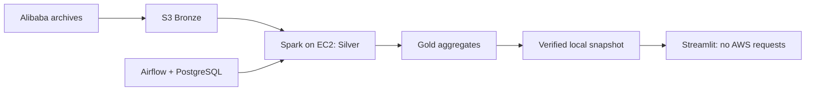

# GPU Fleet Analytics

A capacity-planning dashboard backed by an AWS data engineering pipeline on Alibaba GPU Cluster Trace v2026.

**Scale:** 9,049 source files · 6.76 billion Silver rows · 185 Gold days · seven dashboard tables.

**Status — November 23, 2026:** AWS processing complete; 47.4-MB Gold bundle downloaded and verified. Streamlit works offline. EC2 is stopped. Public deployment is pending.



## Dashboard

One page: **find pressure → review existing capacity → test a requirement**. One selected cohort carries through all three steps. Supporting data and definitions stay collapsed below.

Requests are not verified running demand. Missing telemetry remains unknown. Flagged evidence is excluded by default; scenarios are exploratory, not purchase or reclaim recommendations.

## Run locally

Python3.11; no Java, Spark or AWS credentials needed at dashboard runtime.

```bash
python3.11 -m venv .venv
source .venv/bin/activate
pip install -r requirements-dashboard.txt
streamlit run dashboard.py
```

Place the verified bundle in `data/gold/gold_20261120/`, or set `GOLD_BUNDLE_DIR`. Data is gitignored; source-only clones must supply the bundle. For a clearly labeled synthetic demo, use a new empty directory:

```bash
python examples/make_dashboard_sample.py /tmp/gpu-dashboard-demo
GOLD_BUNDLE_DIR=/tmp/gpu-dashboard-demo streamlit run dashboard.py
```

[Dashboard setup and metric rules](docs/runbooks/DASHBOARD.md) · [one-time download](examples/download_gold.py)

## Verify the work

[Saved AWS evidence](docs/evidence/README.md) includes S3 manifests, Spark application IDs, fingerprints, measured benchmarks, final Airflow results and stopped EC2 state. [Local validation](docs/evidence/local-gold-verification.json) covers file hashes, schemas,185 inventory reconciliations and five workload populations. UI tests block network access.

```bash
python3 examples/verify_evidence.py
python examples/verify_gold_bundle.py data/gold/gold_20261120
python -m unittest discover -s tests -p test_dashboard.py -v
```

## Repository

| Location | Purpose |
|---|---|
| `dashboard.py`, `dashboard_data.py` | Offline interface and tested metric calculations |
| `ingest_bronze.py`, `silver.py`, `gold.py` | Verified ingestion and versioned medallion processing |
| `dags/`, `ops/`, `infra/` | Airflow, guards, exports and AWS infrastructure |
| `tests/`, `examples/` | Regressions, synthetic demos and verification tools |
| [Gold dictionary](docs/data/GOLD_DATA_DICTIONARY.md) · [source profile](docs/data/BRONZE_PROFILE.md) | Every Gold column, table grain, units and limits |
| [Design](docs/design/GOLD_TRANSFORMATION_PLAN.md) · [runbooks](docs/runbooks/README.md) | Metric definitions and reproduction |
| [HANDOFF](HANDOFF.md) | Current state and continuation instructions |

Legacy pilot: `pipeline.py`, `examples/pilot_dashboard.py`, and the two older DAGs. Historical checkpoints: `docs/archive/`. CI is configured; saved local test results are separate from hosted CI status.

Source: [Alibaba GPU Cluster Trace v2026](https://github.com/alibaba/clusterdata/tree/master/cluster-trace-gpu-v2026). Released labels are preserved; XPU cohorts are anonymized and not assumed interchangeable.
