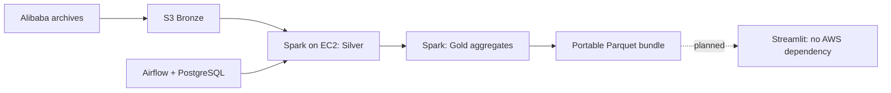

# GPU Fleet Analytics

An AWS data engineering project for GPU infrastructure capacity planning, using Alibaba GPU Cluster Trace v2026.

**Scale:** four source tables · 9,049 Parquet files · 6.76 billion rows · 356.28 GB of downloaded archives.

**Status — November 21, 2026:** Silver and Gold verified complete. Gold: 185 days, seven tables, 47.4-MB export, 8h52m runtime. EC2 stopped. Local bundle download and the final capacity dashboard remain pending.



## Verify the AWS work

Start with the [evidence index](docs/evidence/README.md): saved S3 manifests, Spark application IDs, source/code fingerprints, EC2 configuration, benchmark results, and validation reports. No AWS account is needed to inspect them.

```bash
python3 examples/verify_evidence.py
```

Evidence records actual runs; planned features are labeled. GitHub Actions is configured, but a successful hosted CI run is not claimed.

## Engineering decisions

- Preserve original Bronze Parquet; verify ZIP-member CRCs and S3 inventories.
- Process one dataset/day per Airflow task on one CPU EC2 worker; Spark local[6], 12-GiB heap.
- Retain unknowns and fractional requests; quarantine conflicting inventory keys; record column-level quality.
- Publish immutable Silver attempts, then replace current manifests: retries do not duplicate visible partitions.
- Guard disk/runtime, checkpoint metadata, and stop compute after completion/failure.
- Keep network days109–115 and global execution context separate from the185-day workload/inventory window.

## Run the local pilot

Requires Python3.11 and Java17. Synthetic data; no AWS credentials.

```bash
python3.11 -m venv .venv
source .venv/bin/activate
pip install -r requirements.txt
unset SPARK_HOME TRACE_BUCKET
export SPARK_LOCAL_IP=127.0.0.1
export PYSPARK_PYTHON="$(command -v python)"
python examples/make_sample.py
TRACE_DIR=sample python pipeline.py network 109
streamlit run dashboard.py
```

For the full-width Silver implementation and Airflow setup, use the [Silver runbook](docs/runbooks/SILVER_RUNBOOK.md). The pilot does not reproduce the full AWS backfill.

## Repository guide

| Location | Purpose |
|---|---|
| `ingest_bronze.py`, `silver.py`, `gold.py` | Verified ingestion, full-width Silver and capacity Gold |
| `dags/gpu_{silver,gold}.py`, `ops/` | Serial Airflow orchestration, safeguards and offline export |
| `infra/` | CloudFormation templates and operator scripts |
| `tests/`, `examples/` | Regression tests, synthetic demos and evidence verification |
| [Data](docs/data/BRONZE_PROFILE.md) · [contracts](docs/data/COLUMN_CONTRACTS.md) | Dataset profile and edge-case handling |
| [Gold design](docs/design/GOLD_TRANSFORMATION_PLAN.md) · [runbook](docs/runbooks/GOLD_RUNBOOK.md) | Metrics, quality gates and offline delivery |
| [AWS evidence](docs/evidence/README.md) · [runbooks](docs/runbooks/README.md) | Execution records and reproduction instructions |
| [HANDOFF.md](HANDOFF.md) | Current operations and continuation instructions |

`pipeline.py`, `dashboard.py`, and the two older DAGs are pilot code; they do not implement the planned capacity dashboard. Historical decisions are under `docs/archive/`.

Source: [Alibaba GPU Cluster Trace v2026](https://github.com/alibaba/clusterdata/tree/master/cluster-trace-gpu-v2026). GPU labels are anonymized; observations support investigations and explicit scenarios, not automatic purchase or reclaim recommendations.
