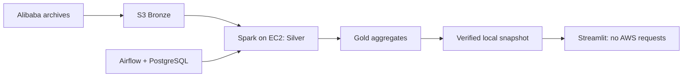

# GPU Fleet Analytics

A capacity-planning dashboard backed by an AWS data engineering pipeline on Alibaba GPU Cluster Trace v2026.

**Scale:** 9,049 source files · 6.76 billion Silver rows · 185 Gold days · seven dashboard tables.

**Status — November 24, 2026:** AWS processing complete; 47.4-MB Gold bundle downloaded and verified. Streamlit works offline. EC2 is stopped. Public deployment is pending.



## Dashboard

Three tabs: **Demand pressure → Existing GPUs → Plan for growth**. Click a GPU bar to carry that selection through the journey. Supporting definitions stay collapsed below.

Requests are not verified running demand. Missing telemetry remains unknown. Flagged evidence is excluded by default; scenarios are exploratory, not purchase or reclaim recommendations.

## Run locally

Python3.11; no Java, Spark or AWS credentials needed at dashboard runtime.

```bash
python3.11 -m venv .venv
source .venv/bin/activate
pip install -r app/requirements.txt
streamlit run app/dashboard.py
```

Place the verified bundle in `data/gold/gold_20261120/`, or set `GOLD_BUNDLE_DIR`. Data is gitignored; source-only clones must supply the bundle. For a clearly labeled synthetic demo, use a new empty directory:

```bash
python examples/make_dashboard_sample.py /tmp/gpu-dashboard-demo
GOLD_BUNDLE_DIR=/tmp/gpu-dashboard-demo streamlit run app/dashboard.py
```

[Dashboard setup and metric rules](docs/runbooks/DASHBOARD.md) · [one-time download](scripts/download_gold.py)

## Verify the work

[Saved AWS evidence](docs/evidence/README.md) includes S3 manifests, Spark application IDs, fingerprints, measured benchmarks, final Airflow results and stopped EC2 state. [Local validation](docs/evidence/local-gold-verification.json) covers file hashes, schemas,185 inventory reconciliations and five workload populations. UI tests block network access.

```bash
python3 scripts/verify_evidence.py
python scripts/verify_gold_bundle.py data/gold/gold_20261120
python -m unittest discover -s tests -p test_dashboard.py -v
```

## Navigate

| Goal | Start here |
|---|---|
| Use the dashboard | [Setup and metric rules](docs/runbooks/DASHBOARD.md) |
| Understand the data | [Gold dictionary](docs/data/GOLD_DATA_DICTIONARY.md) · [Bronze profile](docs/data/BRONZE_PROFILE.md) |
| Verify AWS execution | [Evidence](docs/evidence/README.md) · [Verification tools](scripts/README.md) |
| Understand transformations | [Column contracts](docs/data/COLUMN_CONTRACTS.md) · [Gold design](docs/design/GOLD_TRANSFORMATION_PLAN.md) |
| Reproduce processing | [Runbooks](docs/runbooks/README.md) · [Infrastructure](infra/README.md) |
| Continue development | [Current handoff](HANDOFF.md) · [Documentation map](docs/README.md) |

Dashboard dependencies: `app/requirements.txt`. Processing dependencies: `pipelines/requirements.txt`.

## Code map

| Location | Responsibility |
|---|---|
| [app/](app/README.md) | Streamlit interface and local metric calculations |
| [pipelines/](pipelines/README.md) | Bronze, Silver and Gold processing; source bytes preserved from AWS runs |
| [dags/](dags/README.md) | Airflow scheduling |
| [ops/](ops/README.md), `infra/` | Worker tasks, run guards and AWS setup |
| [scripts/](scripts/README.md) | One-time download and offline verification |
| [examples/](examples/README.md), `tests/` | Synthetic fixtures, experiments and regression tests |
| [data/](data/README.md) | Gitignored local production bundle |

Earlier pilot: `pipelines/pipeline.py` and files marked pilot in the directory guides. Superseded documentation lives in `docs/archive/`. CI is configured; saved local results do not establish hosted CI success.

Source: [Alibaba GPU Cluster Trace v2026](https://github.com/alibaba/clusterdata/tree/master/cluster-trace-gpu-v2026). Released labels are preserved; XPU cohorts are anonymized and not assumed interchangeable.
