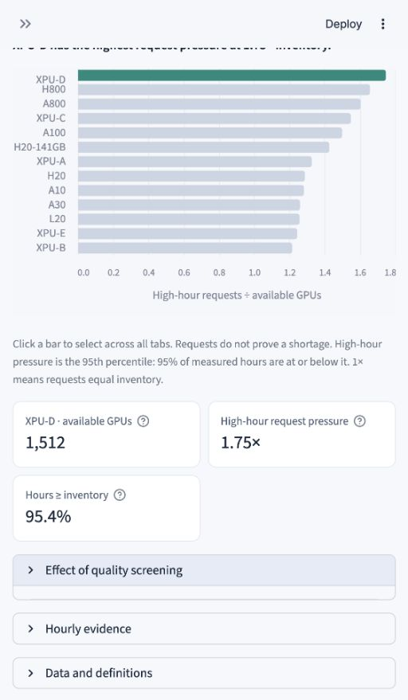
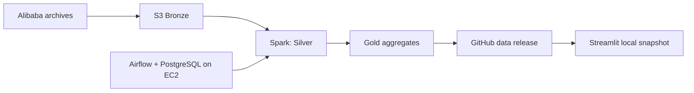

# GPU Fleet Analytics

Review GPU request pressure, investigate existing capacity, and test growth assumptions using Alibaba’s six-month cluster trace.

**[Live dashboard](https://gpu-fleet-analytics.streamlit.app/) · [AWS execution evidence](docs/evidence/README.md) · [Data dictionary](docs/data/GOLD_DATA_DICTIONARY.md)**


**Processed on AWS:** 9,049 source files → 6.76 billion Silver rows → seven Gold tables across 185 trace days. Airflow orchestrated Spark on one 8-vCPU / 32-GiB EC2 worker. Gold completed in 8h52m; its 47.4-MB export serves the dashboard without S3 requests.



## Findings

- **Pressure varies by GPU type.** XPU-D has the highest screened p95 request/inventory ratio at **1.75×** across the full trace. This measures observed requests; it does not establish waiting workloads or a buying quantity.
- **Screening removes substantial coverage.** Repeated candidate keys flag **53 of 185 days**. For A100, screening changes p95 pressure from **1.51× to 1.50×**, with **4,440 → 3,167** evidenced hours. The dashboard exposes both estimates for the same selection.
- **Lifecycle data limits purchase conclusions.** `Unknown` state accounts for **99.0% of raw GPU request weight**. The growth calculator is an explicit assumption-based scenario, not a demand forecast.

[Recorded calculations](docs/evidence/portfolio-findings.json) use the saved `gold_20261120` release, all clusters and days 0–184. Request-weighted state shares include flagged records; pressure figures are labeled by screening policy.

## Architecture and decisions



- **One CPU worker:** representative-day benchmarks supported a bounded single-machine run; Spark parallelized locally with six threads.
- **Safe reruns:** immutable attempts and a final manifest pointer prevent failed retries from replacing accepted outputs. Consumers resolve one accepted version per partition.
- **Schema drift:** read native Parquet types before safe normalization; preserve uncertain values with quality flags rather than silently deduplicating them.
- **Portable delivery:** a checksum-pinned GitHub asset is installed once per host; visitor interactions read local Parquet files.

## Run locally

Python 3.11; dashboard runtime needs no Spark, Java or AWS credentials.

```bash
python3.11 -m venv .venv
source .venv/bin/activate
pip install -r app/requirements.txt
streamlit run app/dashboard.py
```

Missing default data downloads from the [Gold release](https://github.com/shrutidoshi94/gpu-fleet-analytics/releases/tag/gold-data-20261120). For a supplied local bundle, set `GOLD_BUNDLE_DIR`. [Deployment and metric rules](docs/runbooks/DASHBOARD.md).

## Verify and explore

```bash
python -m scripts.verify_evidence
python -m scripts.verify_gold_bundle data/gold/gold_20261120
python -m unittest discover -s tests -p test_dashboard.py -v
```

| Location | Purpose |
|---|---|
| `app/` | Dashboard tabs, metric calculations and verified startup data |
| `pipelines/`, `dags/` | Spark transformations and Airflow ordering/retries |
| `infra/`, `ops/` | Current deployment path, worker tasks and run controls |
| `tests/`, `examples/` | Regression tests and explicit synthetic fixtures |
| `scripts/` | Packaging, download and verification tools |
| `docs/` | [Data contracts](docs/data/COLUMN_CONTRACTS.md), [design](docs/design/GOLD_TRANSFORMATION_PLAN.md), [runbooks](docs/runbooks/README.md) and execution evidence |

[CI runs](https://github.com/shrutidoshi94/gpu-fleet-analytics/actions) test the dashboard and synthetic Spark/Airflow workflows. [AWS setup](infra/README.md) documents the revised deployment path and its validation boundary. Recorded deployed sources remain with the evidence; current refactored code has a new source identity. Earlier pilot code is labeled in `examples/` and `pipelines/`.

## Dataset attribution and usage

Data: [Alibaba GPU Cluster Trace v2026](https://github.com/alibaba/clusterdata/tree/master/cluster-trace-gpu-v2026), published by Alibaba Group. Network covers only days 109–115; execution summaries have no daily mapping. GPU types are not assumed interchangeable.

**Usage terms:** Alibaba permits research and study use in its [Cluster Trace Program terms](https://github.com/alibaba/clusterdata#our-motivation). The v2026 release provides no separate named license; consult upstream terms for permitted use.

Requested citation: Suyi Li et al., *Heterogeneity at Hyperscale: Characterization and Scheduling of Large Production AI Clusters at Alibaba*, OSDI 2026. [Paper and citation](https://github.com/alibaba/clusterdata/tree/master/cluster-trace-gpu-v2026#introduction).
