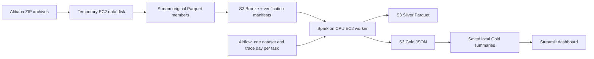

> Historical checkpoint. Superseded by the root README and HANDOFF.

# GPU fleet analytics

## Current operation — authorized Silver recovery running

Updated November 19, 2026, 7:57 PM Pacific. The user authorized the full Bronze-to-Silver transformation. Airflow run `silver_full_20261119_r2` started at 7:50:54 PM Pacific on the existing m6a.2xlarge (8 vCPU / 32 GiB), with the approved 60-GiB gp3 root, Spark local[6] and 12-GiB driver heap. Latest snapshot: 3/378 transformation partitions succeeded, one running, no failed tasks, 52.97 GiB disk free. This is a dated snapshot; read live status before taking action.

The initial full attempt failed on pod day5/hour06 because one source file uses integer numeric fields and null-only utilization fields. A full audit of all 9,049 Bronze footers is now complete. The reader groups native physical schemas and permits only safe widening, rejecting unsafe integer-to-double values beyond ±2^53. Added null/blank/Unknown/non-finite/boolean counts and partition-scoped source observations. Day5/hour06 has zero requests but some positive GPU activity: preserve and flag it; do not interpret it as proven idle capacity. See [BRONZE_PROFILE.md](../data/BRONZE_PROFILE.md) and the 46-field [COLUMN_CONTRACTS.md](../data/COLUMN_CONTRACTS.md). Footer coverage does not prove every row-level semantic invariant.

All 12 local recovery regression tests passed. The actual failing pod day5 (27,805,129 rows), inventory day5, and final join audit passed under the production Airflow scheduler before R2 started. Prior immutable attempts remain available; changed code/source identity causes reprocessing, not blind reuse. Consumers must resolve current manifests, never wildcard versions. Gold is not part of this run.

PostgreSQL15 and Airflow3.0.6 LocalExecutor are configured and validated in isolated production paths. Only the Silver DAG is loaded. API/scheduler/DAG processor are active; API binds 127.0.0.1:8080 and is available locally through an SSM tunnel. No inbound security-group port was opened. Legacy SQLite/pilot DAG history is preserved and inactive.

Worker health is checked every minute; comprehensive health checks and PostgreSQL checkpoints are saved every two hours. The supervisor fails on permanent task failure, stopped orchestration services, disk below10 GiB, or a30-hour runtime limit. Success requires all378 current partition manifests and192 final inventory audit bindings to verify. The service has a31-hour cap and boot guard34hours. Failure/completion finalization preserves evidence and shuts down EC2. The first attempt's finalizer timed out because of an Airflow service dependency cycle; that dependency was removed, shutdown is nonblocking, and a separate180-second shutdown watchdog was verified to survive finalizer timeout. Do not restart the old run or change these guards casually.

Live evidence: `s3://gpu-fleet-network-demo-tracebucket-ojk2fpexu8a6/run-logs/full-silver-20261119/status.json`, `health-checks.jsonl`, task reports and metadata checkpoints in the same prefix. Check status freshness, `run_outcome`, `verified_complete`, and `service-result.json`; a historical DAG state alone is not sufficient. Worker: `i-09dc0bfe45b0d275f`, account498768607823, profile `gpu-fleet`, region `us-east-2`. Do not stop a healthy authorized run. No second worker or500-GiB disk is needed.

The pre-repair benchmark forecast was16–25hours and ~$7–$11 before credits including short retention. Additional quality checks/reprocessing can change that estimate; it is not a completion guarantee. AWS credit balance is delayed/shared. New capacity-planner Gold and offline export/dashboard require a subsequent implementation/review phase.

## Earlier design and benchmark checkpoint (superseded execution state)

The current operation above overrides older paused/unapproved/setup-pending statements below. Earlier measurements and proposed Gold designs remain historical evidence.

## Verified benchmark complete — worker stopped

All 9 benchmark cases and 4 final join audits completed. The existing worker is **stopped** as m6a.2xlarge (8 vCPU / 32 GiB) with the user-approved 60-GiB gp3 root (3,000 IOPS / 125 MiB/s). The tested single-worker Bronze-to-Silver scenario is **16–25 hours**, approximately **$7–$11 before credits** including short storage retention; Gold and production scheduler setup are excluded. Eight unique Silver partitions are committed, 370 remain. Recommend the tested single worker; no parallel-machine speedup is claimed. Network109 has 190 retained unmatched inventory observations. See [AWS_BENCHMARK_RESULTS.md](../evidence/AWS_BENCHMARK_RESULTS.md) for measurements, cost assumptions, coverage and alternatives. Full backfill remains unapproved; older status sections below are historical.


## Silver implementation and validation

`silver.py` and `gpu_silver_backfill` implement the full-width Silver-only path: CPU-only workloads are retained, source schemas/inventories and row accounting are checked, quality/quarantine data is recorded, and immutable attempts are exposed through current-version manifests. The real-data benchmark and final audits passed. See [SILVER_RUNBOOK.md](../runbooks/SILVER_RUNBOOK.md) and [AWS_BENCHMARK_RESULTS.md](../evidence/AWS_BENCHMARK_RESULTS.md). Legacy `pipeline.py` still creates narrow pilot Silver and Gold together; it is not the new Silver entry point. The capacity-planner Gold layer/dashboard and persistent production Airflow/PostgreSQL setup are not implemented yet. The full backfill awaits the user's topology decision.

Credit evidence: the user supplied management-account screenshots showing $153.53 estimated remaining and all four credit service lists covering EC2/S3/VPC/data transfer, and confirmed sharing activated for the project account. This is shared, delayed balance evidence, not a live guarantee. Prices were refreshed through AWS Pricing API on November 19, 2026.


A portfolio data engineering project for **GPU infrastructure capacity planners**, built on Alibaba's GPU Cluster Trace v2026. Its planned dashboard focuses on capacity pressure, efficiency-review opportunities, placement/mix, and assumption-based sizing scenarios. It uses **Airflow** to orchestrate trace days, preserves raw **Bronze** data in **Amazon S3**, runs **Spark** transformations for **Silver and Gold**, and uses **Streamlit** to explore saved Gold summaries. The dashboard continues working after AWS resources are deleted.

## Product scope

The target user is a capacity planner making infrastructure purchasing and efficiency decisions. The proposed primary views are capacity outlook, efficiency evidence, placement/mix, and explicit planning scenarios. Network uses only its aligned seven-day window; execution summaries are separate global context. The trace alone does not establish complete unmet demand, hardware interchangeability, safe reclaim amounts, or purchase quantities. See the audience/decision contract in [PROCESSING_STRATEGY.md](../design/PROCESSING_STRATEGY.md). This design is proposed; the current dashboard is still a basic pilot viewer and processing remains paused.

## Next phase: choose the full-run topology

The Silver-only pipeline is implemented and benchmarked on small/reference/large workload days, three inventory days, network109 and global execution. The tested recommendation is one m6a.2xlarge (8 vCPU / 32 GiB), six Spark threads and 12-GiB driver heap, with the approved 60-GiB gp3 root. The measured planning scenario is 16–25 hours for Silver including final audits, roughly $7–$11 before credits with short retention. Two-machine throughput and smaller-memory hosts are unmeasured. Finalize the topology, configure/validate persistent Airflow LocalExecutor/PostgreSQL, and agree on a full-run runtime policy before starting. EC2 remains stopped. Gold is a separate subsequent phase.

## Current status

Snapshot: **November 19, 2026**. See [HANDOFF.md](../../HANDOFF.md) for the latest operational state, AWS resource IDs, commands, and evidence.

- All four downloads and archive verification finished successfully. Original Parquet data is preserved in verified S3 Bronze.
- Network, server inventory, and execution summaries are ingested and verified in S3 Bronze.
- Workload Bronze migration is complete: 4,440 original Parquet files (351.8 GB) passed source CRC, destination size/metadata, and full inventory checks. All four dataset success manifests exist.
- Direct-S3 Spark processing passed for network day 109, server day 109, and the global execution summary. Independent PyArrow checks matched Bronze aggregates and actual S3 Silver row counts to Gold.
- Network day 109 was also rerun to verify replacement without duplicates, removal of stale files, and preservation of neighboring days.
- All four S3-only pilots and offline Gold dashboard checks passed. Workload day 109 took about 100 seconds and produced six groups from 2.82 million GPU-requesting pod-hours. A later legacy pilot rerun was canceled; those legacy outputs remain historical. The new versioned full-width Silver day109 is validated. The full backfill is pending.
- **The full backfill is paused** pending topology selection. The completed benchmark worker is confirmed stopped as m6a.2xlarge; its root is now 60 GiB after explicit approval. The temporary 500 GiB data volume remains deleted. All 9 benchmark cases and 4 final audits passed. See [PROCESSING_STRATEGY.md](../design/PROCESSING_STRATEGY.md).
- GitHub Actions is configured; it has not yet been executed on GitHub.

## Understand the data before processing

[PROCESSING_STRATEGY.md](../design/PROCESSING_STRATEGY.md) now contains ten actual Bronze rows from each table, an extra GPU-requesting workload sample, actual file schemas, interpretation cautions, and a proposed insight-to-Gold mapping. Full sample values and provenance are in [docs/bronze_samples](../bronze_samples/README.md). These are examples, not representative distributions. Benchmark results are separate; the full backfill remains paused.

## Dataset

| Dataset / CLI name | Download archive | Compressed size | Coverage | Analysis |
|---|---|---:|---|---|
| Network / `network` | `asi_opensource_network_hourly.zip` | 203,904,100 bytes (~204 MB) | Days 109–115 | Hourly receive/transmit traffic per observed server |
| Server inventory / `server` | `asi_opensource_server_hourly.zip` | 3,080,121,387 bytes (~3.08 GB) | Days 0–184 | GPU capacity and GPU-model mix |
| Workloads / `pod` | `asi_opensource_pod_hourly.zip` | 351,803,513,445 bytes (~352 GB) | Days 0–184 | Observed GPU SM utilization by workload type |
| Execution summary / `execution` | `asi_opensource_job_execution_summary.zip` | 1,188,295,031 bytes (~1.19 GB) | Global, not day-partitioned | Execution-duration distributions |

The four ZIPs total **356.28 decimal GB**, approximately **331.81 GiB**. Archive sizes are different from extracted storage requirements. Trace days are relative to recording start; they are not calendar dates.

## Architecture



**Bronze** preserves original Parquet bytes. The ingestion program reads ZIP members directly rather than fully unzipping every archive onto disk. It validates member CRCs, verifies uploaded object sizes and source metadata, and compares the complete S3 key/size inventory before publishing a dataset success manifest.

**Silver** contains the processing-ready records. Workload analysis filters to positive GPU requests; execution analysis also requires a nonnegative duration. Server inventory excludes records without a server ID. Network processing selects the traffic fields and discovered hour partition.

**Gold** contains small JSON reports: hourly network means, GPU-spec capacity summaries, workload-type mean SM utilization, and workload-type execution-duration statistics. Execution durations include mean, approximate median, and approximate 95th percentile.

The initial implementation extracts one day locally and publishes each layer to S3. The expanded `--from-bronze` path reads verified Bronze **directly from S3 through S3A**, stages Silver/Gold and Spark scratch files on the system disk, then publishes to S3. It does not need the original ZIPs for transformation.

This is a single-node Spark implementation. Airflow currently executes pilots through its local DAG test runner; a persistent production scheduler and multi-worker deployment have not been established.

## Repository map

| File | Purpose |
|---|---|
| `ingest_bronze.py` | Resumable ZIP-member ingestion and S3 inventory verification |
| `pipeline.py` | Daily Spark transformations and S3 publication |
| `dags/gpu_trace.py` | One selected dataset/day; supports local archives or S3 Bronze |
| `dags/gpu_backfill.py` | Serial mapped tasks over selected datasets and day range |
| `dashboard.py` | Displays local or uploaded Gold JSON, without AWS access |
| `examples/make_sample.py` | Generates a small synthetic network archive |
| `examples/verify_gold.py` | Independently checks S3 Bronze, Silver row counts, and Gold aggregates |
| `tests/` | Synthetic end-to-end, replacement, offline dashboard, and archive-layout checks |
| `infra/network-demo.json` | Original worker, private bucket, IAM role, and security group |
| `infra/data-volume.json` | Separate temporary 500 GiB encrypted gp3 volume |
| `infra/scripts/` | Recorded operational setup and monitoring scripts; review deployment-specific IDs before reuse |
| `HANDOFF.md` | Live operations history and continuation instructions |

## Local synthetic demonstration

Prerequisites: **Python 3.11** and **Java 17**. From the repository root:

```bash
python3.11 -m venv .venv
source .venv/bin/activate
pip install -r requirements.txt
unset SPARK_HOME TRACE_BUCKET
export PYSPARK_PYTHON="$(command -v python)"
export SPARK_LOCAL_IP=127.0.0.1
python examples/make_sample.py
TRACE_DIR=sample python pipeline.py network 109
```

Use the installed PySpark version rather than a conflicting system Spark installation. On Apple Silicon with Homebrew Java 17, set:

```bash
export JAVA_HOME=/opt/homebrew/opt/openjdk@17/libexec/openjdk.jdk/Contents/Home
```

Set JAVA_HOME before running Spark. On other platforms, point it at the local Java 17 installation.

Run the dashboard or regression checks separately:

```bash
streamlit run dashboard.py
python -m unittest discover -s tests -v
```

The sample has 48 synthetic server-hour observations and produces 24 hourly Gold rows. Tests verify expected means, replacement on retry, neighboring-day preservation, rejection of incomplete days, and offline dashboard rendering.

## EC2 runtime and credentials

Use a Linux CPU worker with Java 17, Python 3.11, AWS CLI, and an instance role scoped to the project bucket. The deployed region is **Ohio (`us-east-2`)**; local operations use the named CLI profile `gpu-fleet`. No GPU instance is required to analyze these traces.

Use Session Manager with no inbound application or SSH ports. Credentials stay outside Git; the worker uses its instance role.

On the worker, activate the project environment and configure paths:

```bash
export TRACE_PROJECT="$PWD"
export TRACE_BUCKET=your-project-bucket
export AWS_DEFAULT_REGION=us-east-2
export TRACE_DIR=/data/gpu-fleet/archives
export TMPDIR="$TRACE_PROJECT/scratch"
export SPARK_LOCAL_DIRS="$TRACE_PROJECT/scratch"
export SPARK_LOCAL_IP=127.0.0.1
export PYSPARK_PYTHON="$(command -v python)"
export PYSPARK_SUBMIT_ARGS='--master local[2] --driver-memory 2g --conf spark.sql.shuffle.partitions=4 pyspark-shell'
unset SPARK_HOME
mkdir -p "$TMPDIR"
```

These Spark settings match the current 2-CPU / 8 GiB worker. If the worker is resized, change Spark parallelism and memory too. Keep system-disk headroom for one day's Silver output and spills.

## Download and ingest Bronze

All four downloads are already on the deployed worker; do not restart completed downloads unnecessarily. The recorded downloader in `infra/scripts/download-archives.sh` supports resumed downloads, expected-size checks, a free-space reserve, and local SHA256 recording. SHA256 recording is not a comparison with a trusted upstream checksum. Current operations and runtime overrides are documented in HANDOFF.md.

To ingest a fully downloaded archive:

```bash
python ingest_bronze.py network --archive-dir "$TRACE_DIR" --bucket "$TRACE_BUCKET"
python ingest_bronze.py server --archive-dir "$TRACE_DIR" --bucket "$TRACE_BUCKET"
python ingest_bronze.py execution --archive-dir "$TRACE_DIR" --bucket "$TRACE_BUCKET"
python ingest_bronze.py pod --archive-dir "$TRACE_DIR" --bucket "$TRACE_BUCKET"
```

Ingestion resumes by skipping objects whose length and source CRC metadata already match. It removes obsolete objects only within the selected dataset's Bronze prefix. Use a dedicated bucket and serialize ingestion with processing of the same dataset.

S3 layout:

```text
bronze/{network,server,pod}/day=N/hour=HH/*.parquet
bronze/execution/all/*.parquet
manifests/bronze/{dataset}.json
manifests/bronze/{dataset}.success.json
silver/{network,server,pod}/day=N/*.parquet
silver/execution/all/*.parquet
gold/{network,server,pod}/day=N/summary.json
gold/execution/all/summary.json
run-logs/
```

Each dataset success manifest is written only after its entire source inventory is verified. `pipeline.py --from-bronze` requires that marker.

## Process verified S3 Bronze

```bash
python pipeline.py network 109 --from-bronze
python pipeline.py server 109 --from-bronze
python pipeline.py pod 109 --from-bronze
python pipeline.py execution 0 --from-bronze
```

The execution dataset ignores daily partitioning and produces one global report with `day: null`. The first S3 run resolves `org.apache.hadoop:hadoop-aws:3.3.4` and matching dependencies from Maven; outbound HTTPS is required. This Hadoop version matches the pinned Spark 3.5.5 runtime.

To independently validate an output against S3 Bronze and Silver:

```bash
python examples/verify_gold.py pod 109 --bucket "$TRACE_BUCKET"
```

The validator downloads the selected Bronze/Silver partition to temporary system-disk space, so allow room for both during verification.

### Reruns and publication boundaries

A transformation replaces the selected dataset/day prefix using S3 sync with deletion of stale output files. It does not append another copy of the same day. Other dataset/day prefixes are preserved.

Updates across layers are sequential, **not an atomic transaction**. Consume Gold after task success. Do not run overlapping single-day/backfill tasks for the same output prefix. A failed transformation can leave older Gold alongside partially replaced Silver until a successful retry.

## Airflow orchestration

Install project requirements first, then the pinned Airflow environment:

```bash
pip install 'apache-airflow==3.0.6' \
  --constraint https://raw.githubusercontent.com/apache/airflow/constraints-3.0.6/constraints-3.11.txt
pip check
export AIRFLOW_HOME="$TRACE_PROJECT/airflow-home"
export AIRFLOW__CORE__DAGS_FOLDER="$TRACE_PROJECT/dags"
airflow db migrate
```

Streamlit 1.48.1 and boto3 1.39.11 are pinned for compatibility with this tested setup.

For a single S3-backed day:

```bash
airflow dags test gpu_trace_day 2026-01-01 \
  --conf '{"dataset":"network","day":109,"from_bronze":true}'
```

For the workload-only benchmark through the mapped backfill DAG:

```bash
airflow dags test gpu_medallion_backfill 2026-01-04 \
  --conf '{"start_day":109,"end_day":109,"datasets":["pod"]}'
```

For a full backfill after pilot, capacity, and cost checks:

```bash
airflow dags test gpu_medallion_backfill 2026-01-05 \
  --conf '{"start_day":0,"end_day":184}'
```

By default, all four datasets are selected. The full range creates **378 serial tasks**: 185 server days, 185 workload days, seven network days, and one global execution summary. The DAG uses `max_active_tasks=1`; multiple EC2 workers are not coordinated by this implementation. `datasets` can restrict a run to selected tables, for example excluding an already processed global summary.

The dates in these commands are Airflow logical dates, not dates from the trace. `dags test` executes the DAG locally; it does not start a persistent scheduler. For the local demonstration UI/scheduler, run `airflow standalone` with the same environment and trigger the DAG with the same parameters. For a synthetic Airflow run, set TRACE_DIR to the absolute sample directory, unset TRACE_BUCKET, and use `from_bronze: false`.

## Keep the dashboard after AWS teardown

Download all successful Gold outputs to the laptop before deleting AWS data:

```bash
mkdir -p output/gold
aws s3 sync "s3://$TRACE_BUCKET/gold/" output/gold/ --profile gpu-fleet
streamlit run dashboard.py
```

The dashboard reads only Gold JSON: it needs no AWS credentials, Spark runtime, ZIP archive, or EC2 worker. It supports selecting local reports or uploading a single summary JSON, including the global execution report. Keep a separate backup because `output/` is gitignored. Saved Gold is enough to display the results; recomputing them later requires retaining Bronze or obtaining the source trace again.

## Storage, costs, and cleanup

The temporary **500 GiB encrypted gp3 data volume** held the downloaded ZIPs and has now been deleted after S3 verification. It is not required for S3-based transformation once Bronze migration and independent processing checks pass. S3 is object storage; it cannot itself fetch an external URL or unzip an archive. EC2 performs those operations in this project.

Approximate Ohio rates verified November 18–19, 2026, before credits and taxes:

| Resource | Rate |
|---|---:|
| Current `t3.large` worker | $0.0832/hour while running |
| Public IPv4 | $0.005/hour while allocated |
| 500 GiB gp3 data volume | $40/month, prorated |
| 30 GiB gp3 system volume | $2.40/month, prorated |

S3 storage and requests are additional and grow with Bronze/Silver retention. EBS has no pause state: stopping EC2 or detaching a disk does not stop disk storage charges. Promotional-credit balance and eligible products must be verified in AWS Billing; the Free Tier eligible label is separate from promotional-credit coverage.

Before removing the temporary data disk:

1. Require all four Bronze success manifests and verified inventories.
2. Pass a workload pilot and independent checks using S3 input and system-disk scratch.
3. Preserve required source evidence and Gold backups.
4. Obtain deletion approval, stop archive readers/reporters, update paths, remove its fstab entry, and unmount it.
5. Delete the separate data-volume stack; verify the volume is deleted.

The worker is confirmed stopped at the user's request, with processing paused for strategy review; automatic download shutdown was canceled. After processing finishes, stop/terminate compute when appropriate. Deleting the original worker stack removes its system disk but intentionally retains the S3 bucket. Delete the data-volume stack before deleting the worker stack, and remove retained S3 objects/bucket only after saving the required results. See HANDOFF.md and `infra/PLAN.md` for deployment-specific details.

## Source and interpretation

[Alibaba GPU Cluster Trace v2026](https://github.com/alibaba/clusterdata/tree/master/cluster-trace-gpu-v2026), [archive sizes/layout](https://github.com/alibaba/clusterdata/blob/master/cluster-trace-gpu-v2026/docs/data_download.md), and [schema](https://github.com/alibaba/clusterdata/blob/master/cluster-trace-gpu-v2026/docs/schema.md).

Cite Li et al., *Heterogeneity at Hyperscale: Characterization and Scheduling of Large Production AI Clusters at Alibaba*, OSDI 2026, when using the trace.

Mean SM utilization gives each non-null GPU-requesting pod-hour equal weight and is reported in source units. It does not estimate the fraction of the entire fleet in use. Inventory GPU-hours describe observed capacity, and network means describe observed servers. The synthetic sample is for validation and is not production telemetry.
